# skj

**Your AI agent does the Jira grunt work. You press yes.**

A community project for Jira Cloud, tested live on a real team-managed project; company-managed projects, approvals by a second user and token storage on Linux and Windows are not yet run: see [Status](#status).

`skj` turns a story in your Jira Cloud project into a pull request, one small step at a time, with every change shown to you first.
It works with [Spec Kit](https://github.com/github/spec-kit), which helps you (or your AI agent) go from an idea
to a spec, a plan and a task list. Your agent does the building; `skj` puts the subtasks, the pull request and the finished checklist on the story
and leaves your time for the questions, the tangents and the yes. It is for developers and teams on Jira Cloud who let an AI coding agent build, and want every change to Jira to wait for a person.

*Plain Python, standard library only. Your token stays out of the repository and is sent only to your own Jira site.*

```bash
pipx install "git+https://github.com/praveenlavu/spec-kit-jira@v0.1.0"
skj setup --site your-site.atlassian.net --project PROJ
skj doctor
```

`skj doctor` changes nothing and names the fix for each check that fails, such as a token not stored yet ([all five steps](#quick-start)). Not in 0.1: company-managed projects, Jira Data Center, scoped API tokens and pull request hosts other than GitHub ([the full list](#status)).

[Quick start](#quick-start) · [Slash commands](#spec-kit-slash-commands) · [Workflow](#the-jira-lifecycle-workflow) · [Status](#status)

## Why you'll like it

Once the spec and the plan are agreed, an agent can write the code and the tests. The part that needs you comes first.

- **Questions and choices reach the team before any code.** `skj questions --post` shows the open questions and `skj decisions` records each choice in a plain file; add `--apply` to post them to the story.
- **You approve, the agent builds.** Every command that writes to Jira shows a preview and waits for your yes. With `--expect-plan` the apply does exactly the plan you read; if it changed in between, nothing is written.
- **Every criterion has its test.** A checklist ties each acceptance criterion to the test that proves it, and the gate, an automatic check before merge, reports any criterion without one.
- **When in doubt, it stops.** A changed plan, a missing approval or settings it cannot trust end the command with nothing written.
- **The story shows the work, and you close it.** Subtasks, the pull request link and the finished checklist go on the story, and the branch name carries the story key. The workflow ends at the open pull request; `skj` closes the story only with `skj done`, after the merge and your yes.

## Why this exists, and how it compares

An AI agent with a Jira token can change a story the moment it decides to. `skj` puts you back at each point where the story
changes: the agent prepares the change, you read it, and only your yes applies it. The longer version: [why skj](docs/why.md). How that compares:

- **An agent that writes to Jira on its own:** you see a change only after it is made. With `skj` you see it before, and say yes.
- **A general Jira command line tool, or an MCP server (a set of tools an agent can call):** it does what it is asked, when asked. `skj` makes a plan and waits for a person.
- **Its sibling kit for another tracker:** the same shape and the same rules; this one is for Jira Cloud ([other trackers](#also-for-other-trackers)).

### Before and after

| By hand | With `skj` |
|---|---|
| Open questions are asked wherever the team happens to talk. | Questions are posted to the story before the plan is approved. |
| You copy the tasks into subtasks and keep them in step yourself. | `skj push` creates one subtask per task, after you see the preview. |
| You check by eye that each acceptance criterion has a test. | `skj gate` reports each criterion that has no test, before merge. |
| You link the pull request to the story yourself. | `skj pr link` links them; `skj done` attaches the checklist and closes the story. |

## How it works

```mermaid
flowchart TD
    A(["Story PROJ-123"]) --> B["skj get and skj dod seed<br/>read the story, start the checklist"]
    B --> C["Spec<br/>written with Spec Kit"]
    C --> G1{"You review<br/>the spec"}
    G1 -->|changes| C
    G1 -->|yes| Q["skj questions --post<br/>preview of the questions"]
    Q --> G2{"You approve<br/>the questions?"}
    G2 -->|no| Q
    G2 -->|"yes, add --apply"| T{"Your team answers<br/>on the story"}
    T --> P["Plan<br/>written with Spec Kit"]
    P --> G3{"You review<br/>the plan"}
    G3 -->|changes| P
    G3 -->|yes| D["Task list<br/>tasks.md"]
    D --> E["skj push<br/>preview of the subtasks"]
    E --> G4{"You approve<br/>the preview?"}
    G4 -->|no| D
    G4 -->|"yes, add --apply"| F["Subtasks appear in Jira"]
    F --> I["Build<br/>tests first, then code"]
    I --> J["skj gate<br/>automatic check"]
    J -->|gaps| I
    J -->|clear| K["skj pr create<br/>preview of the pull request"]
    K --> G5{"You approve<br/>the preview?"}
    G5 -->|no| K
    G5 -->|"yes, add --apply"| L["Pull request opened"]
    L --> G6{"Your team reviews<br/>and merges"}
    G6 -->|merged| M["skj pr link<br/>link on the story"]
    M --> N["skj done<br/>preview: attach the checklist, close the story"]
    N --> G7{"You approve<br/>the preview?"}
    G7 -->|no| N
    G7 -->|"yes, add --apply"| O(["Story is Done"])

    classDef start fill:#d6eaff,stroke:#2f6fb5,color:#10304f;
    classDef work fill:#e3f5e1,stroke:#3a8a3a,color:#123512;
    classDef human fill:#fff0c2,stroke:#b58900,stroke-width:3px,color:#3d2f00;
    classDef tool fill:#efe0ff,stroke:#7a4fb5,color:#2e1450;
    class A,O start;
    class C,P,D,F,I,L work;
    class G1,G2,T,G3,G4,G5,G6,G7 human;
    class B,Q,E,J,K,M,N tool;
```



Yellow diamonds with a thick border are people's decisions. Purple boxes are `skj` commands. Green boxes are work and its results. Blue marks the start and the end.
Nothing reaches Jira until you add `--apply`. You can run the steps yourself, ask your AI agent to run the
[Spec Kit slash commands](#spec-kit-slash-commands), or start [the workflow](#the-jira-lifecycle-workflow), which waits for you at each human approval gate.
Words such as gate and checklist are explained in the [glossary](docs/glossary.md).

## Quick start

You need Python 3.9 or newer, `git`, a Jira Cloud account and a story with a section titled "Acceptance criteria". The workflow runs your agent headless, so with Claude Code it needs the permission list in [docs/claude-permissions.json](docs/claude-permissions.json) first ([how](docs/quick-start.md#the-workflow-runs-the-agent-headless)).
Nothing in these steps changes your Jira site. The same steps with example output: [docs/quick-start.md](docs/quick-start.md).

**1. Install.**

```bash
pipx install "git+https://github.com/praveenlavu/spec-kit-jira@v0.1.0"
skj --version
```

**2. Store your Jira API token** (macOS). Make the token in your Atlassian account settings first. This line asks for it and hides what you type. On Linux, skip this step: step 3 asks for it instead.

```bash
security add-generic-password -a 'you@example.com' -s 'skj:your-site.atlassian.net' -w
```

**3. Connect your repository** to your site and project. This writes `skj.config.json` (no secrets in it). Commit it to your main branch.

```bash
skj setup --site your-site.atlassian.net --project PROJ
```

**4. Check the setup.** One line per check. A `fail` line tells you how to fix it.

```bash
skj doctor
```

**5. Try your first story.** Read it, start its checklist, and ask what comes next.

```bash
skj get PROJ-123
skj dod seed PROJ-123 --spec-dir specs/001-my-feature
skj status PROJ-123
```

## Install the Spec Kit add-on

The add-on gives your AI agent 13 commands. Run this inside your Spec Kit project (the folder where you ran `specify init`).

```bash
specify extension add jira-lifecycle --from https://github.com/praveenlavu/spec-kit-jira/archive/refs/tags/v0.1.0.zip
```

From a local copy of this repository instead: `specify extension add --dev <path-to-your-copy>`.

### Spec Kit slash commands

Type these in your agent. Agents that install them as skills use hyphens instead, for example `/speckit-jira-lifecycle-push` (Codex: `$speckit-jira-lifecycle-push`). Every command that writes to Jira shows a preview first and waits for your yes.

| Command | What it does |
|---|---|
| `/speckit.jira-lifecycle.setup` | Checks your tools, writes `skj.config.json`, checks the connection and which kit runs each phase. |
| `/speckit.jira-lifecycle.constitution` | Adds the Jira and human-approval articles to your project constitution, keeping what is there. |
| `/speckit.jira-lifecycle.pull` | Turns the story into a spec and a checklist, ready for your spec review. |
| `/speckit.jira-lifecycle.plan` | Runs the plan phase and makes sure the checklist's plan section is filled. |
| `/speckit.jira-lifecycle.tasks` | Runs the tasks phase and makes sure there is a `tasks.md` to push. |
| `/speckit.jira-lifecycle.implement` | Runs the build, tests first, and keeps the checklist up to date. |
| `/speckit.jira-lifecycle.push` | Previews the subtasks for `tasks.md`, then creates or updates them after your yes. |
| `/speckit.jira-lifecycle.gate` | Runs the gate and records the result in the checklist. |
| `/speckit.jira-lifecycle.review` | Reviews the branch's changes and records the findings in the checklist. |
| `/speckit.jira-lifecycle.pr` | Previews the pull request, then pushes the branch and opens it after your yes. |
| `/speckit.jira-lifecycle.status` | Says which stage the story is at and the one command that moves it on. Changes nothing. |
| `/speckit.jira-lifecycle.done` | Ticks the checklist with evidence, then attaches it and closes the story after your yes. |
| `/speckit.jira-lifecycle.stack` | Finds your stack and a matching kit for you to approve. It never installs a kit. |

### The jira-lifecycle workflow

The workflow takes the story from the spec to an open pull request. It stops at 12 human approval gates and waits for your yes at each; the last one comes after the pull request opens. After the merge, close the story with `skj done`.
Add it from your copy, then start it in your own terminal with the story's number (the digits after the project key, `123` for `PROJ-123`):

```bash
specify workflow add --dev <path-to-your-copy>/workflows/jira-lifecycle
specify workflow run jira-lifecycle --input issue_number=<n>
```

Every input and every step, with the purpose of each approval gate, is in [the workflow's own README](workflows/jira-lifecycle/README.md).

## Everyday commands

Replace `PROJ-123` with your story. Most commands also take just the number, such as `123`.

| What you want | Command | What happens |
|---|---|---|
| Look at a story | `skj get PROJ-123` | Prints its status, type and parent. Changes nothing. |
| Read its comments | `skj comments PROJ-123 --md` | Lists them with their text. Changes nothing. |
| See where a story stands | `skj status PROJ-123` | Names the stage and the one command that moves it on. |
| Start the checklist | `skj dod seed PROJ-123` | Writes `dod/DoD_PROJ-123.md` from the story. |
| Update the checklist | `skj dod refresh PROJ-123` | Re-reads the story. Your own sections stay as they are. Refused when there is no checklist yet (run `skj dod seed` first) or it is over 1 MiB. |
| Name a branch | `skj branch PROJ-123` | Shows the name. Add `--apply` to create it (local only). |
| Record a decision | `skj decisions PROJ-123 --add "Use email login" --kind decision` | Saves a line in a local file. |
| Send decisions to the story | `skj decisions PROJ-123 --post` | Shows the comment. Add `--apply` to post it. |
| Ask the team questions | `skj questions PROJ-123 --post` | Shows the comment. Add `--apply` to post it. |
| Create subtasks | `skj push PROJ-123` | Shows the plan. Add `--apply` to create them. |
| Pull the business rules | `skj rules PROJ-123` | Copies the rules from the parent Epic into `dod/Rules_PROJ-123.md`. Add `--confirm` to record that a person reviewed them (local only). |
| Check before merge | `skj gate PROJ-123` | Prints what is missing. Changes nothing. |
| Open a pull request | `skj pr create PROJ-123` | Shows the plan. Add `--apply` to open it (needs the `gh` tool). |
| Link the merged pull request | `skj pr link PROJ-123 --url https://github.com/your-org/your-repo/pull/42` | Shows the plan. Add `--apply` to link. |
| Close the story | `skj done PROJ-123` | Shows the plan. Add `--apply` to attach the checklist and move the story to Done. |
| Strict mode checks (tests first, enforced; see the [glossary](docs/glossary.md)) | `skj strict check PROJ-123 --phase implement` | Checks the strict rules of that phase. Changes nothing. |
| Your project's stack | `skj stack detect` | Shows which languages and test tools it finds. See [stack and kits](docs/stack-and-kits.md). |
| Installed add-ons | `skj kits verify` | Says whether each Spec Kit add-on is the one a person reviewed. |
| Test your AI reviewer | `skj calibrate --emit .skj/calibrate.md` | Writes a short quiz that checks your AI model judges tests correctly. |
| Comment approval | `skj approvals check PROJ-123 --gate approve-push` | Experimental: see below. |

Every command has `--help`, for example `skj push --help`. To be sure an apply does exactly what you read, save the preview with `--plan-out` and apply with `--expect-plan` (see [security and trust](docs/security-and-trust.md)).

## Safety promises

The trust model in five promises; the whole model is in [security and trust](docs/security-and-trust.md).

- **Preview first.** Every command that changes Jira or opens a pull request shows the change and does nothing until you add `--apply`.
  (If you copy in the optional link check for GitHub, it adds the link after a merge: the merge is your yes.)
- **Your token stays private.** It lives in your keychain (macOS) or a private file in your home folder (for the optional GitHub check, in a GitHub secret), never in the repository.
- **Trust settings come from your main branch.** Who may approve, and the site your token is sent to, are read from the branch a pull request targets, so editing them on a branch changes nothing. On your own computer that branch is the one your clone's `origin/HEAD` names; when `origin/main` (or `origin/master` if there is no `origin/main`) is in strict mode or comment approval, `skj` refuses to run if `origin/HEAD` names any other branch, and uses that branch when `origin/HEAD` is not set. Your clone itself is as trusted as your computer: creating, rewriting or deleting any `refs/remotes/origin/*` ref in the local clone is not detected; CI reads the real remote. In CI, with `--base origin/<target>` or else the branch `origin/HEAD` names, a pull request into another branch beside a strict `origin/main` is judged by `origin/main`'s config; otherwise by its target's config when that is strict, else by the pull request's own. When both the target branch and `origin/main` are strict, the target branch's gate settings apply (only the mode is compared). The templates use `fetch-depth: 0`; a checkout without it reads a fresh `--base` as before ([details](docs/security-and-trust.md#trust-settings-come-from-the-target-branch)).
- **Jira text is data.** Story and comment text is never run and never obeyed. Where the story title is used in a pull request
  title or a branch name, it is cleaned first and passed as a single argument, never through a shell.
- **No smart commits.** It never writes Jira smart-commit commands (like `#done` in a commit message), and the gate warns about them.
- **It never deletes.** Removed tasks are reported in the preview; their subtasks are left alone.

## Comment approval is experimental

By default you approve each step in your own terminal. Terminal approval remains the recommended mode.
You can instead let named people approve by a comment on the story: a decision with `/approve D3`, or a step with the `/approve <step> <hash>` line that `skj` prints when it is waiting for one. That mode is experimental, and on most sites it can only show tampering, not prevent it:

On this site the token can edit or delete comments, including its own, so an approval can be shown to have been tampered with only if it was edited; a deleted comment leaves no trace; comment approval is experimental and cannot be made tamper-proof.

`skj doctor` prints that sentence in the `edit-all` row when it applies. Details: [security and trust](docs/security-and-trust.md).

## Status

This is an early version (0.1.0).
- **Tested live on a real Jira Cloud Free site, on a team-managed project (2026-11).** About 600 live checks covered setup and doctor, get and comments (including more than 100 comments and pagination), the branch dry run, dod seed and refresh with acceptance-criteria drift, decisions, questions (posted once, never duplicated), push of subtasks, the gate, strict mode (its refusals and its success path, up to `done` closing a story), business rules on a real Epic parent chain, pr link, done with the ledger attachment, the Spec Kit add-on and its 13 commands, the bundle and a security sweep; the 23 defects they found are fixed and re-tested. The `jira-lifecycle` workflow, driven by Claude Code, ran end to end on a story, up to a pull request on a private GitHub repository; a rejected gate left Jira unchanged, and a second and third run added no duplicate comment or subtask. The final pass ran 143 of 143 checks green. Running the workflow found six problems (among them the headless permissions, a missing check after each agent step and a stale ledger at the review approval gates), all fixed. A `/approve D1` line typed in the Jira editor is stored as plain text. Not yet run live: comment approval by a second user and an edit by someone else (comment approval stays experimental), company-managed projects, real 429, 503, timeout and 403 answers, the token store on Linux and Windows, the copy-in GitHub checks in a repository of their own and a pull request from a fork, and `skj done` after a real merge with a decision a human validated.
- **Team-managed projects only.** Company-managed projects are not tested; `skj doctor` warns about them in the `project-type` row.
- **Works today:** setup, doctor, get, comments, status, dod, branch, decisions, questions, push, gate, pr create, pr link, done,
  strict mode, stack, kits, calibrate, business rules (`skj rules`, checked by the gate and strict mode), the Spec Kit add-on and its
  `jira-lifecycle` workflow, the copy-in GitHub checks in [ci/](ci/README.md), and comment approval (experimental). The kit's own workflows have run on GitHub; the GitHub checks in ci/ have not yet run in a repository of their own.
- **Not in 0.1:** a `skj strict override` command (not in 0.1: an override is a hand-written decision line of kind `override`), an approval-request comment,
  single-item write commands (create, update, comment, link, attach one item), downloading attachments, company-managed projects,
  scoped API tokens, Jira Data Center, and pull request hosts other than GitHub. The `unattended` settings are accepted but not used yet.
  What is still unproven is listed in [docs/unverified.md](docs/unverified.md).

## If something goes wrong

Run `skj doctor` first. Each line names a check and how to fix it; the common ones are in [the quick start](docs/quick-start.md#if-something-goes-wrong).

## Also for other trackers

Each kit is a separate, independent project.

- **Azure DevOps:** [spec-kit-ado](https://github.com/praveenlavu/spec-kit-ado), for Azure DevOps work items.

## Learn more

- **Start:** [quick start, with example output](docs/quick-start.md), [glossary](docs/glossary.md), [why skj](docs/why.md) and [what is not proven yet](docs/unverified.md).
- **Set up:** [every setting in skj.config.json](docs/configuration.md), [what it runs on](docs/compatibility.md), [stack and kits](docs/stack-and-kits.md), [checks for GitHub](docs/ci.md) and the templates in [ci/README.md](ci/README.md).
- **Trust:** [security and trust](docs/security-and-trust.md), [the security policy](SECURITY.md) and [the AI agent's runbook](AGENTS.md).
- **Project:** [contributing](CONTRIBUTING.md), [the changelog](CHANGELOG.md), [versioning](VERSIONING.md), [the release checklist](docs/release-checklist.md), [the catalog submission checklist](docs/catalog-submission.md) and [text for listings](docs/launch-copy.md).

## License and trademarks

MIT licensed: see [LICENSE](LICENSE).
Not affiliated with or endorsed by Atlassian. Jira is a trademark of Atlassian.
A community project, not an official GitHub product.
