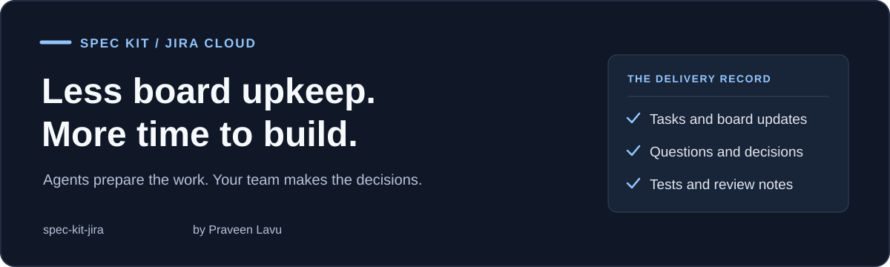
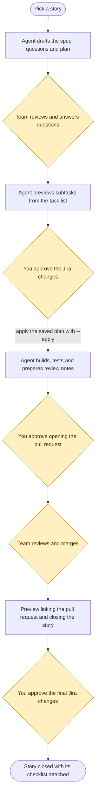

# spec-kit-jira



**Keep Jira in step with the work.**

A Spec Kit add-on for Jira Cloud, with the `skj` command-line tool. Tested on a real team-managed project: see [Status](#status).

[](https://github.com/praveenlavu/spec-kit-jira/actions/workflows/tests.yml) [](LICENSE) [](docs/compatibility.md)

`skj` takes a story in your Jira Cloud project toward a pull request alongside [Spec Kit](https://github.com/github/spec-kit), which helps your agent write a spec, a plan and a task list.

Your agent prepares subtasks, records questions and decisions, and assembles the delivery checklist. Your team spends less time copying tasks and writing handover notes, and more time deciding what to build.

You review the exact change before the agent writes to Jira. A saved preview can be checked again before applying, so a changed plan needs another review.

*Plain Python, standard library only. Your token stays out of the repository and is sent only to your own Jira site.*

```bash
pipx install "git+https://github.com/praveenlavu/spec-kit-jira@v0.1.0"
skj setup --site your-site.atlassian.net --project PROJ
skj doctor
```

`skj doctor` changes nothing and names the fix for each check that fails ([all five steps](#quick-start)).
Not in 0.1: company-managed projects, Jira Data Center and pull request hosts other than GitHub ([the full list](#status)).

[Quick start](#quick-start) · [Slash commands](#spec-kit-slash-commands) · [Workflow](#the-jira-lifecycle-workflow) · [Status](#status)

## See it in 20 seconds

Example output, trimmed, with an invented story and invented tasks. First a preview, then the same command with your yes:

```text
$ skj push PROJ-123 --plan-out .skj/plan-push.md
Plan for PROJ-123: push tasks.md to subtasks (label skj)
create 3 · skip 0 · transition 0 · no-op 0 · refused 0 · orphan 0 · duplicate 0

| action | task | subtask | summary | transition |
|---|---|---|---|---|
| create | T001 | - | T001 Add the login form | - |
| create | T002 | - | T002 Check the email address | - |
| create | T003 | - | T003 Show a clear error message | - |
dry run: nothing written; add --apply to write

$ skj push PROJ-123 --apply --expect-plan .skj/plan-push.md
created T001 PROJ-124
created T002 PROJ-125
created T003 PROJ-126
```

## Why you'll like it

- **Less task copying.** Turns the plan’s task list into subtasks, with a preview of creates, updates and transitions.
- **A clearer record of decisions.** Prepares questions for the story and records assumptions and choices, so your team weighs in early.
- **Evidence beside the story.** A checklist maps each acceptance criterion to a named test; the gate, an automatic check before merge, reports missing coverage. The team still reviews whether the tests prove the requirement.
- **Less handover writing.** Prepares the pull request, links it to the story, and attaches the finished checklist when you close the story after merge; the branch name carries the story key.
- **People decide what changes.** Agent commands preview Jira writes for approval and check the saved plan before applying it.

Updates happen when you run the commands or workflow. This is not a background service that cleans up every story.

## Why this exists, and how it compares

A story’s plan, subtasks, discussion and delivery evidence can end up in different places. `skj` helps your agent maintain those records as the work progresses. Your team sets priorities, answers product questions and reviews the result. The longer version: [why skj](docs/why.md).

| By hand | With `skj` |
|---|---|
| Open questions are asked wherever the team happens to talk. | Questions go to the story before the plan is approved. |
| You copy the tasks into subtasks and keep them in step yourself. | One subtask per task, created after you see the preview. |
| You check by eye that each acceptance criterion has a test. | An automatic check before merge names each one without a test. |
| You link the pull request to the story yourself. | `skj pr link` links it; `skj done` attaches the checklist and closes the story. |

## How it works



Yellow marks the team's decisions and approvals. This is the short version; questions, decisions and other Jira writes have their own previews and approvals.
Nothing reaches Jira until you add `--apply`. You can run the steps yourself, ask your AI agent to run the
[Spec Kit slash commands](#spec-kit-slash-commands), or start [the workflow](#the-jira-lifecycle-workflow), which waits for you at each human approval gate.
Words such as gate and checklist are explained in the [glossary](docs/glossary.md).

## Quick start

You need Python 3.9 or newer, `git`, a Jira Cloud account and a story with a section titled "Acceptance criteria". The workflow runs your agent headless, so with Claude Code it needs the permission list in [docs/claude-permissions.json](docs/claude-permissions.json) first ([how](docs/quick-start.md#the-workflow-runs-the-agent-headless)).
Nothing in these steps changes your Jira site. The same steps with example output: [docs/quick-start.md](docs/quick-start.md).

**1. Install.**
```bash
pipx install "git+https://github.com/praveenlavu/spec-kit-jira@v0.1.0"
skj --version
```

**2. Store your Jira API token** (macOS). Make the token in your Atlassian account settings first. This line asks for it and hides what you type. On Linux, skip this step: step 3 asks for it instead.
```bash
security add-generic-password -a 'you@example.com' -s 'skj:your-site.atlassian.net' -w
```

**3. Connect your repository** to your site and project. This writes `skj.config.json` (no secrets in it). Commit it to your main branch.
```bash
skj setup --site your-site.atlassian.net --project PROJ
```

**4. Check the setup.** One line per check. A `fail` line tells you how to fix it; the common ones are in [the quick start](docs/quick-start.md#if-something-goes-wrong).
```bash
skj doctor
```

**5. Try your first story.** Read it, start its checklist, and ask what comes next.
```bash
skj get PROJ-123
skj dod seed PROJ-123 --spec-dir specs/001-my-feature
skj status PROJ-123
```

## Install the Spec Kit add-on

The add-on gives your AI agent 13 commands. Run the line below inside your Spec Kit project (the folder where you ran `specify init`). From a local copy of this repository instead: `specify extension add --dev <path-to-your-copy>`.

```bash
specify extension add jira-lifecycle --from https://github.com/praveenlavu/spec-kit-jira/archive/refs/tags/v0.1.0.zip
```

### Spec Kit slash commands

Type these in your agent. Agents that install them as skills use hyphens instead, for example `/speckit-jira-lifecycle-push` (Codex: `$speckit-jira-lifecycle-push`). Every command that writes to Jira shows a preview first and waits for your yes.

| Command | What it does |
|---|---|
| `/speckit.jira-lifecycle.setup` | Checks your tools, writes `skj.config.json`, checks the connection and which kit runs each phase. |
| `/speckit.jira-lifecycle.constitution` | Adds the Jira and human-approval articles to your project constitution, keeping what is there. |
| `/speckit.jira-lifecycle.pull` | Turns the story into a spec and a checklist, ready for your spec review. |
| `/speckit.jira-lifecycle.plan` | Runs the plan phase and makes sure the checklist's plan section is filled. |
| `/speckit.jira-lifecycle.tasks` | Runs the tasks phase and makes sure there is a `tasks.md` to push. |
| `/speckit.jira-lifecycle.implement` | Runs the build, tests first, and keeps the checklist up to date. |
| `/speckit.jira-lifecycle.push` | Previews the subtasks for `tasks.md`, then creates or updates them after your yes. |
| `/speckit.jira-lifecycle.gate` | Runs the gate and records the result in the checklist. |
| `/speckit.jira-lifecycle.review` | Reviews the branch's changes and records the findings in the checklist. |
| `/speckit.jira-lifecycle.pr` | Previews the pull request, then pushes the branch and opens it after your yes. |
| `/speckit.jira-lifecycle.status` | Says which stage the story is at and the one command that moves it on. Changes nothing. |
| `/speckit.jira-lifecycle.done` | Ticks the checklist with evidence, then attaches it and closes the story after your yes. |
| `/speckit.jira-lifecycle.stack` | Finds your stack and a matching kit for you to approve. It never installs a kit. |

### The jira-lifecycle workflow

The workflow takes the story from the spec to an open pull request. It stops at 12 human approval gates and waits for your yes at each; the last one comes after the pull request opens. After the merge, close the story with `skj done`.
Add it from your copy, then start it in your own terminal with the story's number (the digits after the project key, `123` for `PROJ-123`):

```bash
specify workflow add --dev <path-to-your-copy>/workflows/jira-lifecycle
specify workflow run jira-lifecycle --input issue_number=<n>
```

Every input and every step, with the purpose of each approval gate, is in [the workflow's own README](workflows/jira-lifecycle/README.md).

## Everyday commands

Replace `PROJ-123` with your story. Most commands also take just the number, such as `123`.

| What you want | Command | What happens |
|---|---|---|
| Look at a story | `skj get PROJ-123` | Prints its status, type and parent. Changes nothing. |
| Read its comments | `skj comments PROJ-123 --md` | Lists them with their text. Changes nothing. |
| See where a story stands | `skj status PROJ-123` | Names the stage and the one command that moves it on. |
| Start the checklist | `skj dod seed PROJ-123` | Writes `dod/DoD_PROJ-123.md` from the story. |
| Update the checklist | `skj dod refresh PROJ-123` | Re-reads the story. Your own sections stay as they are. Refused when there is no checklist yet (run `skj dod seed` first) or it is over 1 MiB. |
| Name a branch | `skj branch PROJ-123` | Shows the name. Add `--apply` to create it (local only). |
| Record a decision | `skj decisions PROJ-123 --add "Use email login" --kind decision` | Saves a line in a local file. |
| Send decisions to the story | `skj decisions PROJ-123 --post` | Shows the comment. Add `--apply` to post it. |
| Ask the team questions | `skj questions PROJ-123 --post` | Shows the comment. Add `--apply` to post it. |
| Create subtasks | `skj push PROJ-123` | Shows the plan. Add `--apply` to create them. |
| Pull the business rules | `skj rules PROJ-123` | Copies the rules from the parent Epic into `dod/Rules_PROJ-123.md`. Add `--confirm` to record that a person reviewed them (local only). |
| Check before merge | `skj gate PROJ-123` | Prints what is missing. Changes nothing. |
| Open a pull request | `skj pr create PROJ-123` | Shows the plan. Add `--apply` to open it (needs the `gh` tool). |
| Link the merged pull request | `skj pr link PROJ-123 --url https://github.com/your-org/your-repo/pull/42` | Shows the plan. Add `--apply` to link. |
| Close the story | `skj done PROJ-123` | Shows the plan. Add `--apply` to attach the checklist and move the story to Done. |
| Strict mode checks (tests first, enforced; see the [glossary](docs/glossary.md)) | `skj strict check PROJ-123 --phase implement` | Checks the strict rules of that phase. Changes nothing. |
| Your project's stack | `skj stack detect` | Shows which languages and test tools it finds. See [stack and kits](docs/stack-and-kits.md). |
| Installed add-ons | `skj kits verify` | Says whether each Spec Kit add-on is the one a person reviewed. |
| Test your AI reviewer | `skj calibrate --emit .skj/calibrate.md` | Writes a short quiz that checks your AI model judges tests correctly. |
| Comment approval | `skj approvals check PROJ-123 --gate approve-push` | Experimental: see below. |

Every command has `--help`, for example `skj push --help`. To be sure an apply does exactly what you read, save the preview with `--plan-out` and apply with `--expect-plan` (see [security and trust](docs/security-and-trust.md)).

## Safety promises

The trust model in five promises; the whole model is in [security and trust](docs/security-and-trust.md).

- **Preview first.** Every command that changes Jira or opens a pull request shows the change and does nothing until you add `--apply`. (If you copy in the optional link check for GitHub, it adds the link after a merge: the merge is your yes.)
- **Your token stays private.** It lives in your keychain (macOS) or a private file in your home folder (for the optional GitHub check, in a GitHub secret), never in the repository.
- **Trust settings come from your main branch.** Who may approve, and the site your token is sent to, are read from the branch a pull request targets, so editing them on a branch changes nothing. On your own computer that branch is the one your clone's `origin/HEAD` names; when `origin/main` (or `origin/master` if there is no `origin/main`) is in strict mode or comment approval, `skj` refuses to run if `origin/HEAD` names any other branch, and uses that branch when `origin/HEAD` is not set. Your clone itself is as trusted as your computer: creating, rewriting or deleting any `refs/remotes/origin/*` ref in the local clone is not detected; CI reads the real remote. In CI, with `--base origin/<target>` or else the branch `origin/HEAD` names, a pull request into another branch beside a strict `origin/main` is judged by `origin/main`'s config; otherwise by its target's config when that is strict, else by the pull request's own. When both the target branch and `origin/main` are strict, the target branch's gate settings apply (only the mode is compared). The templates use `fetch-depth: 0`; a checkout without it reads a fresh `--base` as before ([details](docs/security-and-trust.md#trust-settings-come-from-the-target-branch)).
- **Jira text is data.** Story and comment text is never run and never obeyed. Where the story title is used in a pull request title or a branch name, it is cleaned first and passed as a single argument, never through a shell.
- **No smart commits.** It never writes Jira smart-commit commands (like `#done` in a commit message), and the gate warns about them.
- **It never deletes.** Removed tasks are reported in the preview; their subtasks are left alone.

## Comment approval is experimental

By default you approve each step in your own terminal. Terminal approval remains the recommended mode.
You can instead let named people approve by a comment on the story: a decision with `/approve D3`, or a step with the `/approve <step> <hash>` line that `skj` prints when it is waiting for one. That mode is experimental, and on most sites it can only show tampering, not prevent it:

On this site the token can edit or delete comments, including its own, so an approval can be shown to have been tampered with only if it was edited; a deleted comment leaves no trace; comment approval is experimental and cannot be made tamper-proof.

`skj doctor` prints that sentence in the `edit-all` row when it applies. Details: [security and trust](docs/security-and-trust.md).

## Status

- Tested live on a real Jira Cloud Free site, on a team-managed project (2026-11). Setup, reading stories, subtasks, questions and decisions, the checks before merge, the pull request link, closing a story and the add-on's 13 commands all ran there. The `jira-lifecycle` workflow ran end to end on one story, up to an open pull request, and every problem it found is fixed.
- **Works today:** everything in the command tables on this page, the `jira-lifecycle` workflow and, as an experiment, comment approval. The kit's own workflows have run on GitHub; the GitHub checks in ci/ have not yet run in a repository of their own.
- **Not covered yet:** company-managed projects, approval by a second person (comment approval stays experimental), real "slow down" and "unavailable" answers from Jira, keeping the token on Linux and Windows, pull requests from forks, and `skj done` after a real merge.
- **Not in 0.1:** Jira Data Center, scoped API tokens, pull request hosts other than GitHub, a `skj strict override` command (not in 0.1: an override is a hand-written decision line of kind `override`), single-item write commands, downloading attachments, and the `unattended` settings (accepted, not used yet).
- This is an early version (0.1.0). The long list, with the reason for each item: [docs/unverified.md](docs/unverified.md) and the [changelog](CHANGELOG.md).

## Also for other trackers

Built and maintained by Praveen Lavu. Each kit is a separate, independent project, built to reduce routine delivery work for the team.

- **Azure DevOps:** [spec-kit-ado](https://github.com/praveenlavu/spec-kit-ado), for Azure DevOps work items.
- **GitHub Issues and Projects:** [spec-kit-ghp](https://github.com/praveenlavu/spec-kit-ghp), for user-owned Projects in 0.1.

## Learn more

- **Start:** [quick start, with example output](docs/quick-start.md), [glossary](docs/glossary.md), [why skj](docs/why.md) and [what is not proven yet](docs/unverified.md).
- **Set up:** [every setting in skj.config.json](docs/configuration.md), [what it runs on](docs/compatibility.md), [stack and kits](docs/stack-and-kits.md), [checks for GitHub](docs/ci.md) and the templates in [ci/README.md](ci/README.md).
- **Trust:** [security and trust](docs/security-and-trust.md), [the security policy](SECURITY.md) and [the AI agent's runbook](AGENTS.md).
- **Project:** [contributing](CONTRIBUTING.md), [the changelog](CHANGELOG.md), [versioning](VERSIONING.md), [the release checklist](docs/release-checklist.md), [the catalog submission checklist](docs/catalog-submission.md) and [text for listings](docs/launch-copy.md).

## License and trademarks

MIT licensed: see [LICENSE](LICENSE).
Not affiliated with or endorsed by Atlassian. Jira is a trademark of Atlassian.
A community project, not an official GitHub product.
