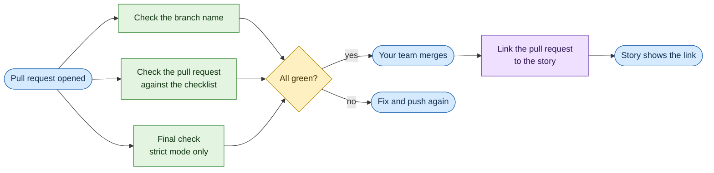

# Checks for GitHub (CI)

"CI" means a robot that runs checks for you whenever code changes. This folder holds four small checks you can
**copy into your own repository**, into `.github/workflows/`. Pick the ones you want; each one works on its own.

(The `skj` project runs its own tests with `.github/workflows/tests.yml`. You do not need that file.)

The "Install skj" line installs `skj` from a full commit of the release, not a tag (a tag can be moved). The actions are already
pinned to full commits too: `actions/checkout` v4.2.2 and `actions/setup-python` v5.6.0 (not yet checked on GitHub against their version tags). If your main branch is not called `main`, change `branches: [main]`.

## The four checks

| File | When it runs | What it checks | Needs your Jira login? |
|---|---|---|---|
| `check-branch-name.yml` | A pull request is opened or updated | The branch name has a story key of your project, like `feature/PROJ-123-add-login`. | No |
| `check-pull-request.yml` | A pull request is opened or updated | `skj gate`: the story's checklist has no gaps. | No (optional: a read-only login) |
| `final-check.yml` | A pull request is opened or updated | Strict mode only: the strict rules, and the tests re-run at each criterion's red and green commit. | **No, never** |
| `link-pull-request.yml` | A pull request is merged | Adds one link to the pull request, and one comment, on the story. Running it twice adds nothing. | Yes, for that one step |

The first three run side by side. Only the last one writes to Jira.

## How to copy them

1. In your repository, make the folder `.github/workflows/` if it is not there.
2. Copy the files you want from `ci/templates/` into it. Keep their names, or pick your own.
3. Replace the placeholders (see above) and commit.
4. In Settings, then Branches, make the checks you rely on **required**, so a red check blocks the merge.

For `link-pull-request.yml` (and the optional Jira part of `check-pull-request.yml`):

1. In Settings, then Secrets and variables, then Actions, add two secrets: `SKJ_EMAIL` (the account's email) and `SKJ_TOKEN` (its API token).
2. Use an account that can comment on your stories and add links, and nothing more. For the gate, one that can only read is enough.
3. To turn on the Jira part of the gate, also add the repository **variable** `SKJ_GATE_ONLINE` with the value `true`
   (see the next section). A strict project with business rules on (`rules.enabled`) must set the repository variable
   `SKJ_GATE_ONLINE` to `true` for the copy-in pull request check: the check runs the gate `--offline` by default, so
   rule drift reads "drift not checked" and strict mode blocks every pull request.

## The Jira part of the gate (optional)

By default `check-pull-request.yml` does not log in to Jira: it skips the comparison with Jira (`--offline`). With the variable
`SKJ_GATE_ONLINE = true` it runs a second version of the check instead, which also catches criteria that changed in Jira after
the checklist was made. Only that one step gets `SKJ_EMAIL` and `SKJ_TOKEN`; use an account that can only read your stories.
The trade-off: one more check, but a Jira login inside CI. Pull requests from forks get no secrets, so for them the comparison
is simply skipped.

## Why they are built this way

- **Each file gets the least access it needs.** All four can only read the code (`contents: read`), and none leaves the GitHub
  token on disk (`persist-credentials: false`).
- **The Jira login is only on the steps that need it.** Never on `final-check.yml`, because that job runs the pull request's own
  test code, and test code could otherwise read the login. `skj` itself refuses to run those tests when it sees a login-like
  variable such as `SKJ_TOKEN`.
- **skj is installed before the pull request's code is fetched**, from an empty folder and in isolated mode (`python -I -m pip`).
  Otherwise a file such as `pip.py` added by a pull request would run instead of pip, and could replace `skj`. Later steps never
  start Python from the pull request's folder without `-I`.
- **Text from the pull request is passed in as variables.** A branch name or a title is text anyone can write. It is never pasted
  straight into a script. The story key is found by a fixed pattern, and the title is handed over as `--title="$TITLE"`
  (with `=`, so a title like `--apply` stays a title).
- **The full history is downloaded** (`fetch-depth: 0`) and the target branch is passed as `--base origin/<branch>`.
  If `skj` cannot find the target branch in CI, it fails on purpose instead of guessing.
- **Pull requests from forks get no secrets** from GitHub. For them the link step says so in a notice and skips the link, and the
  Jira part of the gate skips the comparison.
- **Actions are pinned** to a full commit, so a moved tag cannot change what runs.
- **Make `final-check.yml` a required check.** GitHub does not run checks in an order; inside its own job, final-check runs the
  pull request's tests only after the strict rules have passed.

## Good to know

- A workflow runs as it is written in the pull request's own branch. Anyone who can push a branch to your repository can change
  a workflow file in their pull request, and with it what the check does or which secrets it reads. So: protect `.github/` with a
  CODEOWNERS file and "require review from code owners", give the Jira account only the access it needs, and treat these checks as
  help for honest mistakes, not a lock against people with write access. (Not verified on GitHub yet.)
- `link-pull-request.yml` (and the optional Jira step of `check-pull-request.yml`) points `origin/HEAD` at the pull request's
  target branch (a CI checkout does not set it). When `origin/main` (or `origin/master` if there is no `origin/main`) is in strict
  mode or comment approval, that is not refused in CI: `skj` reads the trust settings and the site from `origin/main`, and a
  judging command (`skj gate`, `skj strict`, `skj stack show`, `skj status`, `skj done`, `skj pr create`) takes the target from
  `--base`, or without `--base` from the branch `origin/HEAD` names. When `origin/main` is strict and the target is not, the pull
  request is judged by `origin/main`'s config, so a pull request into `develop` or `release/1.x` beside a strict `origin/main` is
  judged strict; otherwise by the target's config when the target is strict, else by the pull request's own config.
  When both the target branch and `origin/main` are strict, the target branch's gate settings apply (only the mode is compared). Otherwise `skj` reads the target branch. On your own computer the
  same `origin/HEAD` is refused with `target-moved`. `skj` knows it runs in CI only from the `CI` or `GITHUB_ACTIONS` variable, so
  `CI=1` set on a computer looks the same: the check guards against drift and mistakes, not against whoever controls the clone and
  its environment.

## Earlier names

Earlier build notes called these files by shorter technical names. They are the same checks:

| File here | Earlier name |
|---|---|
| `check-pull-request.yml` | `skj-gate` |
| `check-branch-name.yml` | `skj-branch-guard` |
| `link-pull-request.yml` | `skj-link-on-merge` |
| `final-check.yml` | `skj-strict-verify` |

They live in `ci/templates/`, not in `.github/workflows/`, so they never run in the `skj` repository itself.

## Not built yet

- The gate does not get the list of changed files (`--changed`) yet.
- The gate does not re-read approvals in Jira yet; `skj done` does. A later release adds that check to `check-pull-request.yml`.
